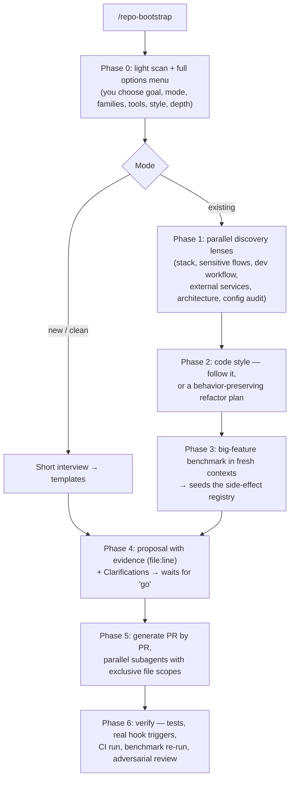

# agentic-repo-kit

Analyze any repo and set up a production-grade AI agent workflow: agents, skills, hooks,
architecture tests, lint guardrails, CI, permissions, MCPs and rulesync. **Asks first, proposes
with evidence, generates only after your go.** Works for new and existing projects, with an
optional behavior-preserving refactor plan.

It ships one Claude Code skill, `/repo-bootstrap`, plus a library of templates. Everything in it
was distilled from a real SaaS codebase where each guardrail was added after a concrete failure.

## Why

Coding agents fail in predictable ways. They start coding before planning. They build custom
engineering when an official SDK or a one-line import already solves the problem. They miss the
side effects one change has on other parts of the system. They call something "done" after mocked
tests pass. And their config grows into thousands of lines of pasted vendor docs and contradictory
rules.

The fix is not a bigger model. In our benchmark, a cheaper model given a written planning protocol
found nearly as many cross-cutting side effects as the most expensive one. Without the protocol,
**no planner checked the provider's docs**, and every one of them missed 3–6 of 18 effects. With a
consumer sweep, a docs-first step, a side-effect registry and a fresh-context reviewer, the
pipeline found ~17 of 18.

This kit packages that method, plus the deterministic guardrails (hooks, lint, architecture tests,
CI) that make the rules impossible to forget.

## Install

As a plugin, from inside Claude Code:

```bash
claude plugin marketplace add rwxce/agentic-repo-kit
claude plugin install agentic-repo-kit@agentic-repo-kit
```

Or copy the skill into a project or into your user skills:

```bash
git clone https://github.com/rwxce/agentic-repo-kit.git
cp -R agentic-repo-kit/skills/repo-bootstrap ~/.claude/skills/              # every project
# or: cp -R agentic-repo-kit/skills/repo-bootstrap <your-repo>/.claude/skills/   # one project
```

Other agent tools that read `SKILL.md`-style skills can use the same folder. The templates are
plain files.

## Use

Open the target repository and run:

```text
/repo-bootstrap            # asks what you want, then proposes
/repo-bootstrap quick      # skip the benchmark
/repo-bootstrap audit      # existing agent config: audit and improve
```

You can also just say "make this repo agent-ready" or "audit my agents and skills".

## How it works



### Phase 0: what it asks you

| Question | Options |
|---|---|
| Goal | build from scratch · audit and improve · only one family |
| Mode | new/clean project · existing project |
| Families | root rules · agents · skills · hooks · architecture tests · custom lint · CI · automations · permissions · registries · MCP servers |
| Tools | Claude Code, Cursor, Codex CLI, OpenCode, Copilot, Gemini CLI… · rulesync as single source (recommended) or native files |
| Code style | follow the existing style · behavior-preserving refactor · leave it alone |
| Depth | quick · full (with benchmark) |
| Output | proposal only · proposal then generation · number of PRs |
| Language | chat in yours; artifacts in English by default |

### What it can set up

Nothing gets proposed without a signal in your repo that justifies it.

| Family | Examples |
|---|---|
| Root rules | plan before code and wait for "go" · Clarifications on questioned plans · docs first · package before custom engineering (reliability checklist) · exact pins at least 5 days old · full-circle verification · review lanes · compliance stop-check · trim with audit |
| Agents | orchestrator / implementer / reviewer roles · per-domain implementers with **Build rules** and a **Handoff brief** · diff reviewer · plan reviewer · reference agents |
| Skills | `plan-feature` (size → consumer sweep → docs first → registry → invariants) · `verify-integration` (per-service recipes) · `reflect` (corrections become rules) · `debugging` · `pr-review` |
| Hooks | outward-writes blocker (fail-closed) · dangerous-command gate with preview · feature-intent router · correction capture · session status · lint if changed · env-docs parity · compliance tripwire · branch policy · PR preflight |
| Architecture tests | directory ↔ registry parity · registry ↔ filesystem · content ↔ assets · unique codes · i18n parity |
| Custom lint | layer boundaries · no cycles · SDK gateways · native deps confined to one runtime · required colocated tests · catch must report · house wrappers |
| CI | AI-config sync check · lint/typecheck/tests · parity checks · PR preflight · branch-policy guard · migration contract gate · review routing |
| Automations | workspace setup (deps, codegen, code index) · release promotion · contract issues · vendored-skill version check |
| Permissions | deny → ask → allow layers for shell, secrets and outward actions |
| Registries | side-effect registry · blueprint (inventory) · environment variables |
| MCP servers | official servers for the services you use, with prod/sandbox split. Proposed only, never installed without your OK |

The full catalog, with the failure behind each item, is in
[`skills/repo-bootstrap/references/guardrail-catalog.md`](skills/repo-bootstrap/references/guardrail-catalog.md).

## Principles

1. **Ask first, write after "go".** Analysis and the proposal are read-only.
2. **Evidence or nothing.** Every artifact cites the `file:line` or config that justifies it.
3. **Docs first.** Official docs or MCP before designing any integration or tool config.
4. **Deterministic over prose.** If a rule can be a hook, a lint rule or a test, it becomes one.
5. **Method over model.** The orchestrator plans with the strongest model. Implementers execute
   with a cheaper one, and reviewers come in with a fresh context.
6. **Trim with audit.** Existing content is never removed based on its title alone.
7. **Never outward without OK.** No installs, auth flows, pushes or publishing on its own.

## Repository layout

```
.claude-plugin/            plugin.json + marketplace.json
skills/repo-bootstrap/
  SKILL.md                 the orchestrator (phases, gates, proposal format)
  references/              loaded on demand: options menu, discovery lenses, code style,
                           benchmark, decision matrix, guardrail catalog, MCP discovery, rulesync
  templates/               rules, agents, skills, registries, hooks (+ tests), arch tests,
                           lint, CI, automations
```

## Developing

The hook templates have no dependencies and are tested with Node's built-in runner:

```bash
node --test skills/repo-bootstrap/templates/hooks/
```

## FAQ

**Does it work without rulesync?** Yes. Choose "native files only" in Phase 0, and it writes
`.claude/` (or your tool's) files directly.

**Will it rewrite my code?** Only if you choose the behavior-preserving refactor. Even then it
produces a separate plan, with characterization tests first and small PRs.

**How much does it cost?** A quick run is roughly 60–120k tokens. The full benchmark adds
roughly 200–300k. The benchmark is the step that finds real gaps, so it is recommended for repos
that handle money, auth or personal data.

**Does it install MCP servers?** No. It proposes official servers with their install commands and
waits for your OK on each one.
