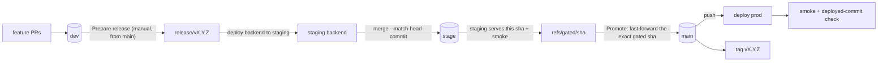

<!--
WHAT: A promotion model (integration -> staging -> production) with workflow sketches, generalized
  from a repo where it ran for months without a bad promotion, then hardened after each near miss
  (a re-run that rolled staging back, a merge that mixed in untested code, a deploy key fallback).
REPO SIGNAL: a staging environment, deploys triggered from branches, and a past case of "what is on
  prod?" being unanswerable, or a hotfix that was lost on the next release. Skip for single-env repos.
CONFIGURE: branch names (<dev>, <stage>, <main>), the bot identity, the CI job name, the staging
  host's "which deploy is published" API, the smoke script, the backend deploy steps, the GitHub
  environments (Stage, Production) and their deployment-branch rule (main only).
-->
# Release flow: dev -> stage -> main



## Rules (each one exists because the opposite broke something)

### Branches and versions

1. **Features land only on `<dev>`.** Hotfixes too: a fix committed directly to stage/main is lost on
   the next release. Land on dev, then release.
2. **`<stage>` accepts PRs only from `release/vX.Y.Z`**, `<main>` accepts none (`ci/branch-policy-guard.yml`).
3. **`<main>` advances by fast-forward only**, to an exact SHA (never "the tip of stage now"): no
   merge commits on prod, so prod is always a commit that was on stage.
4. **The release branch is a snapshot, not a merge.** Build `release/vX.Y.Z` from `<stage>`, then
   `git restore --source=<dev sha> --staged --worktree .` and commit `release: vX.Y.Z`. The tree
   equals that dev commit exactly; there is nothing to resolve. Delete a leftover release branch (and
   close its PR) from a failed run first, so the workflow is re-runnable.
5. **Version comes from the last `release:` commit on stage, not from tags.** Tags are created at
   promotion, and stage runs ahead of main while it is tested, so tag-derived versions repeat. An
   optional explicit version input must be well-formed, strictly greater than the highest `vX.Y.Z`
   tag, and unused (no tag, no `release/` branch). Compare numbers in base 10 (`10#$n`), so a
   leading zero is not read as octal.

### Trust and secrets

6. **Only from main.** The workflow file that runs is the one on the dispatched ref: run from any
   other branch, that branch's code gets the release token and the staging secrets. Check
   `github.ref == refs/heads/main` in the first step (the readable stop) and set the environments'
   deployment-branch rule to main (the hard stop).
7. **`permissions: { contents: read }` at the workflow level; every write goes through the release
   App token.** Job-level permissions only where a job needs more (an explicit map sets every
   omitted scope to none).
8. **Split jobs by the secret they need.** The job holding the push token runs only `git` and `gh`,
   never a repo script, package manager or tool. The job that runs dev's code (install, backend
   deploy) gets only the staging deploy key: `persist-credentials: false`, plus a step that fails if
   any `http.*.extraheader` is still configured.
9. **Pin the target of every environment secret.** If the Stage environment loses a secret, GitHub
   silently falls back to the repository secret of the same name — often the production one. Check
   that the key names the staging deployment before using it.
10. **No caches in jobs that hold production secrets.** Code in any job of the same scope can write
    cache entries, so a cache restored next to prod secrets may have been written by code that never
    passed the gate. The job that runs dev's code skips the shared cache too.
11. **Untrusted strings go through `env:`**, never `${{ }}` inside `run:` (inputs, branch names,
    titles). The smoke script and anything else that receives a secret come from the workflow's own
    commit on main (`ref: ${{ github.sha }}`), never from the release under test.

### Gates

12. **Gate on CI of the exact dev sha** (check-runs API) and build the release from that sha, not
    from `origin/<dev>` again later — dev may move in between. Distinguish "no run yet", "still
    running" and "failed" in the error. Read-only: the default token with `checks: read`; a GitHub
    App token often lacks Checks permission and returns 403.
13. **Re-runs re-check that the release is still current.** "Re-run failed jobs" reuses the first
    attempt's outputs: before deploying, verify `release/vX.Y.Z` still points at the built sha and
    its parent is still the tip of stage, or a re-run rolls staging back to an old snapshot.
14. **Merge with `--match-head-commit <release sha>`** (a push to the release branch after the
    staging deploy makes GitHub refuse), retry only while mergeability is being computed, and then
    **verify the merge commit's tree equals the release commit's tree**: a different tree means stage
    moved and the merge mixed in code CI never saw.
15. **Wait until staging serves that commit**, not until a deploy is "ready": with auto-publishing
    locked (after a rollback) the host builds deploys that it never publishes. Check that stage's tip
    is the expected sha before the smoke and that neither the tip nor the published deploy moved
    during it.
16. **A passed smoke leaves a marker ref** (`refs/gated/<sha>`). Promotion refuses a sha without it,
    so neither a failed smoke's tip nor a stage merge made outside the workflow can reach prod
    through the button. An emergency input may skip it — declared for manual dispatch only (never
    for `workflow_call`, so the automatic path cannot skip the gate) and logged as a warning.
17. **Promotion validates its target**: a full 40-hex sha, the commit exists, it is on stage, main is
    its ancestor (fast-forward), and its subject is `release: vX.Y.Z`.

### Concurrency

18. **Queue releases, never cancel one mid-deploy** (`cancel-in-progress: false`), and keep one lock
    over the whole chain, promotion included, so no other release can move stage between the smoke
    and the push to main. The automatic promotion is a local reusable workflow called inside that
    run (same commit as the caller, i.e. trusted code on main). A manual promotion of "the tip of
    stage" takes the same lock; a promotion of an explicit sha takes its own. In a called workflow
    `github.workflow` is the caller's name, which lets the group expression tell the two apart
    without deadlocking. GitHub keeps one pending run per group: a newer one cancels a queued one.

### Production deploy

19. **Validate the trigger on every event**, manual dispatch included (it deploys with prod secrets
    too): commit on stage, subject `release: vX.Y.Z`. On push also: not forced, pushed by the
    release bot.
20. **Deploy the exact validated sha** (`ref: ${{ github.sha }}`) and refuse if main has moved since
    the run started. Re-check before each later deploy step when there are several.
21. **Deploy order is a contract.** When two runtimes deploy separately (a backend and a worker),
    deploy the side that tolerates the other's old version first, and run migrations last so a
    failed migration only needs a re-run of that step. Write the reason next to the steps.
22. **A failed or cancelled deploy opens (or comments on) one labelled issue** with the run URL, the
    commit and the failed step, so it is not only a red dot nobody opens.
23. **After deploy, check the deployed commit**: the smoke test asks the running app which commit it
    serves and compares with `github.sha`. A green deploy of the wrong commit is the failure this
    catches.
24. **Bot identity**: set `user.name` AND the numeric noreply email of the *bot account*
    (`<id>+<app>[bot]@users.noreply.github.com`), otherwise commits are attributed to a same-named
    public app.

## Sketch: prepare release (manual dispatch from main)

```yaml
name: Prepare release to staging
on:
  workflow_dispatch:
    inputs:
      bump: { type: choice, options: [patch, minor, major], default: patch, required: true }
      promote_automatically: { type: boolean, default: true, required: true }
permissions: { contents: read }          # every write goes through the App token
concurrency: { group: release-prepare, cancel-in-progress: false }
jobs:
  prepare:                               # git + gh only, never a repo script → App token
    runs-on: ubuntu-latest
    permissions: { contents: read, checks: read }
    outputs:
      version: ${{ steps.version.outputs.version }}
      release_sha: ${{ steps.build.outputs.release_sha }}
      has_changes: ${{ steps.build.outputs.has_changes }}
      pr_number: ${{ steps.pr.outputs.number }}
    steps:
      - name: Only from main
        env: { REF: "${{ github.ref }}" }
        run: '[ "$REF" = refs/heads/main ] || { echo "run this from main (got $REF)" >&2; exit 1; }'
      - id: token
        uses: actions/create-github-app-token@v3
        with: { app-id: "${{ vars.RELEASE_APP_ID }}", private-key: "${{ secrets.RELEASE_APP_PRIVATE_KEY }}" }
      # Persists the App token: from here on, only git and gh.
      - uses: actions/checkout@v5
        with: { fetch-depth: 0, token: "${{ steps.token.outputs.token }}" }
      - id: dev_ci
        name: Require green CI on the exact dev sha
        env: { GH_TOKEN: "${{ github.token }}", REPO: "${{ github.repository }}" }
        run: |
          git fetch --no-tags origin <dev>:refs/remotes/origin/<dev>
          sha=$(git rev-parse origin/<dev>)
          run=$(gh api "repos/$REPO/commits/$sha/check-runs" \
                --jq '[.check_runs[] | select(.name=="<ci-job-name>")] | max_by(.started_at)')
          status=$(echo "$run" | jq -r '.status // empty'); concl=$(echo "$run" | jq -r '.conclusion // empty')
          [ -n "$status" ] || { echo "no CI run for $sha yet" >&2; exit 1; }
          [ "$status" = completed ] || { echo "CI still running for $sha" >&2; exit 1; }
          [ "$concl" = success ] || { echo "CI $concl for $sha" >&2; exit 1; }
          echo "sha=$sha" >> "$GITHUB_OUTPUT"     # build from this sha, not from origin/<dev> later
      - id: version
        env: { BUMP: "${{ inputs.bump }}" }
        run: |
          git fetch --no-tags origin --tags "+refs/heads/<stage>:refs/remotes/origin/<stage>"
          latest=$(git log origin/<stage> --grep='^release: v[0-9]' -1 --format=%s | sed -nE 's/^release: (v[0-9]+\.[0-9]+\.[0-9]+).*/\1/p')
          IFS=. read -r M m p <<< "${latest:-v0.0.0}"; M=$((10#${M#v})); m=$((10#$m)); p=$((10#$p))
          case "$BUMP" in major) M=$((M+1)); m=0; p=0;; minor) m=$((m+1)); p=0;; *) p=$((p+1));; esac
          v="v$M.$m.$p"
          git rev-parse -q --verify "refs/tags/$v" >/dev/null && { echo "tag $v exists" >&2; exit 1; }
          echo "version=$v" >> "$GITHUB_OUTPUT"
      - id: build
        name: Snapshot the dev sha onto stage
        env: { V: "${{ steps.version.outputs.version }}", DEV_SHA: "${{ steps.dev_ci.outputs.sha }}" }
        run: |
          git config user.name  "<bot-name>[bot]"
          git config user.email "<bot-numeric-id>+<bot-name>[bot]@users.noreply.github.com"
          git push origin --delete "release/$V" 2>/dev/null || true   # leftover from a failed run
          git switch -c "release/$V" origin/<stage>
          git restore --source="$DEV_SHA" --staged --worktree .
          if git diff --cached --quiet; then echo "has_changes=false" >> "$GITHUB_OUTPUT"; exit 0; fi
          git commit -m "release: $V"
          test -z "$(git diff --stat "$DEV_SHA")" || { echo "snapshot differs from $DEV_SHA" >&2; exit 1; }
          git push -u origin "release/$V"
          echo "has_changes=true" >> "$GITHUB_OUTPUT"
          echo "release_sha=$(git rev-parse HEAD)" >> "$GITHUB_OUTPUT"
      # - id: pr  → open the PR release/$V → <stage> (close a leftover PR from a failed run first)

  backend-stage:                         # the only job that runs dev's code → staging key only
    needs: prepare
    if: needs.prepare.outputs.has_changes == 'true'
    environment: Stage
    permissions: { contents: read }
    runs-on: ubuntu-latest
    steps:
      - name: Release still current (re-runs reuse old outputs)
        env:
          GH_TOKEN: "${{ github.token }}"
          REPO: "${{ github.repository }}"
          V: "${{ needs.prepare.outputs.version }}"
          SHA: "${{ needs.prepare.outputs.release_sha }}"
        run: |
          head=$(gh api "repos/$REPO/git/ref/heads/release/$V" --jq .object.sha 2>/dev/null) || head=""
          [ "$head" = "$SHA" ] || { echo "release/$V moved (${head:-gone}); start a new release" >&2; exit 1; }
          parent=$(gh api "repos/$REPO/commits/$SHA" --jq '.parents[0].sha')
          tip=$(gh api "repos/$REPO/git/ref/heads/<stage>" --jq .object.sha)
          [ "$parent" = "$tip" ] || { echo "stage moved since the build; start a new release" >&2; exit 1; }
      - uses: actions/checkout@v5
        with: { ref: "${{ needs.prepare.outputs.release_sha }}", persist-credentials: false }
      - name: No persisted git credentials
        run: '! git config --get-regexp "^http\..*extraheader$" >/dev/null || { echo "credentials persisted" >&2; exit 1; }'
      - name: The deploy key targets staging (no silent fallback to the prod repo secret)
        env: { KEY: "${{ secrets.<BACKEND_DEPLOY_KEY> }}", STAGE_TARGET: "<staging deployment id>" }
        run: |
          [ -n "$KEY" ] || { echo "missing deploy key in the Stage environment" >&2; exit 1; }
          case "$KEY" in *"$STAGE_TARGET"*) ;; *) echo "key does not target staging" >&2; exit 1;; esac
      - uses: actions/setup-node@v6      # no shared package cache in this job
        with: { node-version-file: .nvmrc }
      # - <install>, <backend deploy>, <run and wait for migrations>

  stage-gate:                            # merge + wait until served + smoke → leaves refs/gated/<sha>
    needs: [prepare, backend-stage]
    if: needs.prepare.outputs.has_changes == 'true'
    environment: Stage
    permissions: { contents: read }
    runs-on: ubuntu-latest
    steps:
      - id: token
        uses: actions/create-github-app-token@v3
        with: { app-id: "${{ vars.RELEASE_APP_ID }}", private-key: "${{ secrets.RELEASE_APP_PRIVATE_KEY }}" }
      # - Squash-merge the release PR with --match-head-commit "$SHA" (skip if already merged on a
      #   re-run; retry only while mergeability is being computed), then compare the merge commit's
      #   tree with the release commit's tree and stop if they differ.
      # - Wait until staging PUBLISHES this commit's deploy (host API), and check stage's tip is still it.
      - uses: actions/checkout@v5          # trusted smoke script: this workflow's commit on main
        with: { ref: "${{ github.sha }}", persist-credentials: false }
      - run: node scripts/smoke-deploy.mjs "<staging-url>"
      # - Check stage's tip and the published deploy did not move during the smoke.
      # - Create refs/gated/<sha> through the git refs API with the App token (idempotent on re-runs).

  promote:                               # inside this run and its lock; same commit as this file
    needs: [prepare, stage-gate]
    if: needs.prepare.outputs.has_changes == 'true' && inputs.promote_automatically
    permissions: { contents: read }
    uses: ./.github/workflows/promote-and-tag.yml
    with: { sha: "<the merged, gated sha from stage-gate>" }
    secrets: { RELEASE_APP_PRIVATE_KEY: "${{ secrets.RELEASE_APP_PRIVATE_KEY }}" }
```

## Sketch: promote to production (called by the release, or by hand from main)

```yaml
name: Promote release to production
on:
  workflow_dispatch:
    inputs:
      sha: { type: string, default: "", required: false }          # empty = tip of stage
      emergency_without_smoke: { type: boolean, default: false, required: false }
  workflow_call:
    inputs: { sha: { type: string, required: true } }              # no emergency input here
    secrets: { RELEASE_APP_PRIVATE_KEY: { required: true } }
permissions: { contents: read }
jobs:
  promote:
    runs-on: ubuntu-latest
    concurrency:   # manual "tip of stage" waits for any release; everything else serializes promotions
      group: ${{ (inputs.sha == '' && github.workflow == 'Promote release to production') && 'release-prepare' || 'promote-and-tag' }}
      cancel-in-progress: false
    steps:
      - name: Only from main
        env: { REF: "${{ github.ref }}" }
        run: '[ "$REF" = refs/heads/main ] || { echo "run this from main" >&2; exit 1; }'
      - id: token
        uses: actions/create-github-app-token@v3
        with: { app-id: "${{ vars.RELEASE_APP_ID }}", private-key: "${{ secrets.RELEASE_APP_PRIVATE_KEY }}" }
      - uses: actions/checkout@v5
        with: { fetch-depth: 0, token: "${{ steps.token.outputs.token }}" }
      - id: target
        env:
          INPUT_SHA: "${{ inputs.sha }}"
          EMERGENCY: "${{ inputs.emergency_without_smoke == true }}"
        run: |
          git fetch --tags origin +refs/heads/<main>:refs/remotes/origin/<main> +refs/heads/<stage>:refs/remotes/origin/<stage>
          if [ -n "$INPUT_SHA" ]; then
            printf '%s' "$INPUT_SHA" | grep -Eqx '[0-9a-f]{40}' || { echo "sha must be 40 hex chars" >&2; exit 1; }
            sha=$INPUT_SHA
          else sha=$(git rev-parse origin/<stage>); fi
          git cat-file -e "$sha^{commit}" 2>/dev/null || { echo "$sha does not exist" >&2; exit 1; }
          git merge-base --is-ancestor "$sha" origin/<stage> || { echo "$sha is not on stage" >&2; exit 1; }
          git merge-base --is-ancestor origin/<main> "$sha" || { echo "not a fast-forward" >&2; exit 1; }
          v=$(git log -1 --format=%s "$sha" | sed -nE 's/^release: (v[0-9]+\.[0-9]+\.[0-9]+)( \(#[0-9]+\))?$/\1/p')
          [ -n "$v" ] || { echo "$sha is not a 'release: vX.Y.Z' commit" >&2; exit 1; }
          if [ "$(git ls-remote origin "refs/gated/$sha" | cut -f1)" != "$sha" ]; then
            [ "$EMERGENCY" = true ] || { echo "$sha did not pass the staging smoke (no refs/gated)" >&2; exit 1; }
            echo "::warning::EMERGENCY: promoting $sha without a staging smoke"
          fi
          echo "sha=$sha" >> "$GITHUB_OUTPUT"; echo "version=$v" >> "$GITHUB_OUTPUT"
      - env: { SHA: "${{ steps.target.outputs.sha }}" }
        run: git push origin "$SHA:refs/heads/<main>"
      - env: { SHA: "${{ steps.target.outputs.sha }}", V: "${{ steps.target.outputs.version }}" }
        run: |
          git ls-remote --tags origin "refs/tags/$V" | grep -q . && { echo "tag $V exists, skipping"; exit 0; }
          git config user.name  "<bot-name>[bot]"; git config user.email "<bot-numeric-id>+<bot-name>[bot]@users.noreply.github.com"
          git tag -a "$V" "$SHA" -m "Release $V" && git push origin "refs/tags/$V"
```

## Sketch: validate the production trigger, deploy, smoke test

```yaml
name: Deploy to production
on:
  push: { branches: [<main>] }
  workflow_dispatch:
permissions: { contents: read }
concurrency: { group: deploy-prod, cancel-in-progress: false }   # never cancel a deploy mid-flight
jobs:
  validate:                              # every event: a manual dispatch deploys with prod secrets too
    runs-on: ubuntu-latest
    steps:
      - uses: actions/checkout@v5
        with: { fetch-depth: 0, persist-credentials: false }
      - env: { EVENT: "${{ github.event_name }}", ACTOR: "${{ github.actor }}", FORCED: "${{ github.event.forced }}", GH_TOKEN: "${{ github.token }}" }
        run: |
          if [ "$EVENT" = push ]; then
            [ "$FORCED" = false ] || { echo "force-push to main refused" >&2; exit 1; }
            [ "$ACTOR" = "<bot-name>[bot]" ] || { echo "only the release bot may promote main (got $ACTOR)" >&2; exit 1; }
          fi
          git -c http.extraheader="AUTHORIZATION: basic $(printf 'x-access-token:%s' "$GH_TOKEN" | base64 | tr -d '\n')" \
            fetch --no-tags origin <stage>:refs/remotes/origin/<stage>
          git merge-base --is-ancestor HEAD origin/<stage> || { echo "main commit not on stage" >&2; exit 1; }
          git log -1 --format=%s HEAD | grep -Eq '^release: v[0-9]+\.[0-9]+\.[0-9]+( \(#[0-9]+\))?$' || { echo "subject is not release: vX.Y.Z" >&2; exit 1; }
  deploy:
    needs: validate
    environment: Production
    permissions: { contents: read, issues: write, actions: read }   # issues/actions: the failure alert
    runs-on: ubuntu-latest
    steps:
      - uses: actions/checkout@v5          # the exact validated commit, never "main now"
        with: { ref: "${{ github.sha }}", persist-credentials: false }
      - name: Refuse a stale deployment
        env: { GH_TOKEN: "${{ github.token }}", REPO: "${{ github.repository }}" }
        run: |
          now=$(gh api "repos/$REPO/git/ref/heads/<main>" --jq .object.sha)
          [ "$now" = "$(git rev-parse HEAD)" ] || { echo "main moved to $now; refusing" >&2; exit 1; }
      - uses: actions/setup-node@v6      # no cache: this job holds production secrets
        with: { node-version-file: .nvmrc }
      # - <install>, then the deploys in contract order (rule 21), migrations last
      # - wait for the migrations to finish, then flag the contract issues they unblock:
      #   <print-migration-status-as-json> | node scripts/mark-ready-contracts.mjs   (issues: write)
      - name: Smoke test + deployed-commit check
        env: { SMOKE_URL: "<prod-url>", EXPECTED_SHA: "${{ github.sha }}" }
        run: node scripts/smoke-deploy.mjs "$SMOKE_URL"   # see contract below
      # - if: failure() || cancelled() → open (or comment on) one open issue labelled
      #   `deploy-failure` with the run URL, the commit and the failed step (rule 22).
```

### Smoke script contract (`scripts/smoke-deploy.mjs`)

Exit non-zero unless: (1) health endpoint returns 200; (2) 3-5 critical public pages return 200 and
contain a stable marker; (3) a protected route redirects to sign-in rather than 200/500; (4) the
version endpoint (`/api/version` or a `<meta name="commit">`, fed by the platform's commit env var at
build time) equals `EXPECTED_SHA`. Retry with backoff for ~2 minutes: the platform may still be
swapping instances. Keep it dependency-free so it also runs against preview URLs
(`workflow_call` with a `url` input).
