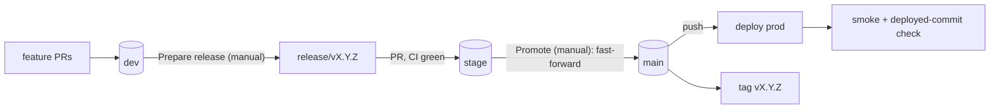

<!--
WHAT: A promotion model (integration -> staging -> production) with workflow sketches, generalized
  from a repo where it ran for months without a bad promotion.
REPO SIGNAL: a staging environment, deploys triggered from branches, and a past case of "what is on
  prod?" being unanswerable, or a hotfix that was lost on the next release. Skip for single-env repos.
CONFIGURE: branch names (<dev>, <stage>, <main>), the bot identity, the smoke script, deploy step.
-->
# Release flow: dev -> stage -> main



## Rules (each one exists because the opposite broke something)

1. **Features land only on `<dev>`.** Hotfixes too: a fix committed directly to stage/main is lost on
   the next release. Land on dev, then release.
2. **`<stage>` accepts PRs only from `release/vX.Y.Z`**, `<main>` accepts none (`ci/branch-policy-guard.yml`).
3. **`<main>` advances by fast-forward only.** `git merge-base --is-ancestor origin/main origin/stage`
   must hold, else abort. No merge commits on prod, so prod is always a commit that was on stage.
4. **The release branch is a snapshot, not a merge.** Build `release/vX.Y.Z` from `<stage>`, then
   `git restore --source=origin/<dev> --staged --worktree .` and commit `release: vX.Y.Z`. The tree
   equals dev exactly (assert `git diff --stat origin/<dev>` is empty); there is nothing to resolve.
   Delete a leftover release branch from a failed run first, so the workflow is re-runnable.
5. **Version comes from the last `release:` commit on stage, not from tags.** Tags are created at
   promotion, and stage runs ahead of main while it is tested, so tag-derived versions repeat.
6. **Gate on CI of the exact dev sha** (check-runs API) before preparing. Read-only: use the default
   token with `checks: read`; a GitHub App token often lacks Checks permission and returns 403.
7. **Bot identity**: set `user.name` AND the numeric noreply email of the *bot account*
   (`<id>+<app>[bot]@users.noreply.github.com`), otherwise commits are attributed to a same-named
   public app.
8. **Production deploy validates its own trigger** (below): not forced, pushed by the release bot,
   commit is an ancestor of stage, subject matches `release: vX.Y.Z`.
9. **After deploy, check the deployed commit**: the smoke test asks the running app which commit it
   serves and compares with `github.sha`. A green deploy of the wrong commit is the failure this
   catches.

## Sketch: prepare release (manual dispatch)

```yaml
name: Prepare release to staging
on:
  workflow_dispatch:
    inputs:
      bump: { type: choice, options: [patch, minor, major], default: patch, required: true }
permissions: { contents: write, pull-requests: write, checks: read }
jobs:
  prepare:
    runs-on: ubuntu-latest
    steps:
      - id: token   # a GitHub App token so the PR it opens triggers workflows (GITHUB_TOKEN PRs do not)
        uses: actions/create-github-app-token@v1
        with: { app-id: "${{ vars.RELEASE_APP_ID }}", private-key: "${{ secrets.RELEASE_APP_PRIVATE_KEY }}" }
      - uses: actions/checkout@v4
        with: { fetch-depth: 0, token: "${{ steps.token.outputs.token }}" }
      - name: Require green CI on dev
        env: { GH_TOKEN: "${{ github.token }}" }
        run: |
          git fetch --no-tags origin <dev>:refs/remotes/origin/<dev>
          sha=$(git rev-parse origin/<dev>)
          run=$(gh api "repos/${{ github.repository }}/commits/$sha/check-runs" \
                --jq '[.check_runs[] | select(.name=="<ci-job-name>")] | max_by(.started_at)')
          [ "$(echo "$run" | jq -r '.status')" = completed ] || { echo "CI not finished for $sha" >&2; exit 1; }
          [ "$(echo "$run" | jq -r '.conclusion')" = success ] || { echo "CI failed for $sha" >&2; exit 1; }
      - id: version
        run: |
          git fetch --no-tags origin --tags "+refs/heads/<stage>:refs/remotes/origin/<stage>"
          latest=$(git log origin/<stage> --grep='^release: v[0-9]' -1 --format=%s | sed -nE 's/^release: (v[0-9]+\.[0-9]+\.[0-9]+).*/\1/p')
          IFS=. read -r M m p <<< "${latest:-v0.0.0}"; M=${M#v}
          case "${{ inputs.bump }}" in major) M=$((M+1)); m=0; p=0;; minor) m=$((m+1)); p=0;; *) p=$((p+1));; esac
          v="v$M.$m.$p"
          git rev-parse -q --verify "refs/tags/$v" && { echo "tag $v exists"; exit 1; } || true
          echo "version=$v" >> "$GITHUB_OUTPUT"
      - name: Snapshot dev onto stage
        run: |
          git config user.name  "<bot-name>[bot]"
          git config user.email "<bot-numeric-id>+<bot-name>[bot]@users.noreply.github.com"
          git fetch origin
          git push origin --delete "release/${{ steps.version.outputs.version }}" 2>/dev/null || true
          git switch -c "release/${{ steps.version.outputs.version }}" origin/<stage>
          git restore --source=origin/<dev> --staged --worktree .
          if git diff --quiet && git diff --cached --quiet; then echo "nothing to release"; exit 0; fi
          git commit -m "release: ${{ steps.version.outputs.version }}"
          test -z "$(git diff --stat origin/<dev>)" || { echo "snapshot differs from dev"; exit 1; }
          git push -u origin "release/${{ steps.version.outputs.version }}"
      # then: gh pr create --base <stage> --head release/vX.Y.Z   (optionally enable auto-merge)
```

## Sketch: promote to production (manual dispatch)

```yaml
name: Promote release to production
on: { workflow_dispatch: {} }
permissions: { contents: write }
jobs:
  promote:
    runs-on: ubuntu-latest
    steps:
      - id: token
        uses: actions/create-github-app-token@v1
        with: { app-id: "${{ vars.RELEASE_APP_ID }}", private-key: "${{ secrets.RELEASE_APP_PRIVATE_KEY }}" }
      - uses: actions/checkout@v4
        with: { fetch-depth: 0, ref: <stage>, token: "${{ steps.token.outputs.token }}" }
      - name: Fast-forward main <- stage (fails if diverged)
        run: |
          git fetch origin
          git merge-base --is-ancestor origin/<main> origin/<stage> || { echo "main diverged from stage: not a fast-forward"; exit 1; }
          git push origin origin/<stage>:refs/heads/<main>
      - name: Tag from the release commit
        run: |
          git fetch origin
          msg=$(git log -1 --format=%s origin/<main>)
          v=$(printf '%s' "$msg" | sed -nE 's/^release: (v[0-9]+\.[0-9]+\.[0-9]+)( \(#[0-9]+\))?$/\1/p')
          [ -n "$v" ] || { echo "main tip is not a 'release: vX.Y.Z' commit: $msg"; exit 1; }
          git ls-remote --tags origin "refs/tags/$v" | grep -q . && { echo "tag $v exists, skipping"; exit 0; }
          git config user.name  "<bot-name>[bot]"; git config user.email "<bot-numeric-id>+<bot-name>[bot]@users.noreply.github.com"
          git tag -a "$v" origin/<main> -m "Release $v" && git push origin "$v"
```

## Sketch: validate the production trigger, deploy, smoke test

```yaml
name: Deploy to production
on:
  push: { branches: [<main>] }
  workflow_dispatch:
concurrency: { group: deploy-prod, cancel-in-progress: false }   # never cancel a deploy mid-flight
jobs:
  validate:
    if: github.event_name == 'push'
    runs-on: ubuntu-latest
    steps:
      - uses: actions/checkout@v4
        with: { fetch-depth: 0, persist-credentials: false }
      - env: { ACTOR: "${{ github.actor }}", FORCED: "${{ github.event.forced }}" }
        run: |
          [ "$FORCED" = false ] || { echo "force-push to main refused" >&2; exit 1; }
          [ "$ACTOR" = "<bot-name>[bot]" ] || { echo "only the release bot may promote main (got $ACTOR)" >&2; exit 1; }
          git fetch --no-tags origin <stage>:refs/remotes/origin/<stage>
          git merge-base --is-ancestor HEAD origin/<stage> || { echo "main commit not on stage" >&2; exit 1; }
          git log -1 --format=%s HEAD | grep -Eq '^release: v[0-9]+\.[0-9]+\.[0-9]+( \(#[0-9]+\))?$' || { echo "subject is not release: vX.Y.Z" >&2; exit 1; }
  deploy:
    needs: validate
    # run on manual dispatch too (validate is skipped there)
    if: ${{ !cancelled() && (needs.validate.result == 'success' || needs.validate.result == 'skipped') }}
    runs-on: ubuntu-latest
    steps:
      - uses: actions/checkout@v4
      # - <deploy step>
      - name: Smoke test + deployed-commit check
        env: { SMOKE_URL: "<prod-url>", EXPECTED_SHA: "${{ github.sha }}" }
        run: node scripts/smoke-deploy.mjs "$SMOKE_URL"   # see contract below
```

### Smoke script contract (`scripts/smoke-deploy.mjs`)

Exit non-zero unless: (1) health endpoint returns 200; (2) 3-5 critical public pages return 200 and
contain a stable marker; (3) a protected route redirects to sign-in rather than 200/500; (4) the
version endpoint (`/api/version` or a `<meta name="commit">`, fed by the platform's commit env var at
build time) equals `EXPECTED_SHA`. Retry with backoff for ~2 minutes: the platform may still be
swapping instances. Keep it dependency-free so it also runs against preview URLs
(`workflow_call` with a `url` input).
