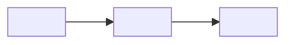

<!--
TEMPLATE: docs/architecture/system-design.md — the system's design on one page: brief, observable
requirements, context and trust boundaries, risks, and the decisions with the check that enforces
each. Filled in Phase 1b (`references/system-design.md`); drafted in `.context/repo-bootstrap/`
and written to the repo only after "go". Signal: standard or deep design depth, or the user asked
for it. Light depth: keep sections 1, 2 and 6 only. Existing project: describe the design as it
is, citing file:line, and list gaps between stated and real design under section 5.
-->
# <Project> system design

Status: <draft | accepted> · Depth: <light | standard | deep> · Last reviewed: <YYYY-MM-DD>

## 1. Brief

- **Users:** <who>
- **Problem:** <one sentence>
- **Success:** <a number or an observable event>
- **Binding constraint:** <budget | deadline | team skills | platform | regulation>
- **Non-goals:** <what this system will not do>

## 2. Observable requirements

| Id | Requirement (EARS) | Observed by | Evidence |
|---|---|---|---|
| R-1 | When <trigger>, the system shall <response>. | <test path / metric / manual step on a real device> | <assumed · read · verified · accepted> |

Quality attributes (numbers, not adjectives):

| Attribute | Target | Observed by |
|---|---|---|
| <p95 latency · offline · monthly cost at launch and at 10x · data residency · supported OS versions> | <value> | <how> |

## 3. Context and trust boundaries

<!-- Optional at light depth. C4 level 1; add level 2 only when there is more than one container. -->

| Boundary | What crosses it | Who authenticates | What validates input | Replay / forgery handling |
|---|---|---|---|---|
| <webhook from X> | <payload> | <signature, key> | <schema> | <dedup key, timestamp window> |

## 4. Methods used

- Method: <name> — <the question it answered here>
<!-- or: Methods: none (<why>) -->

## 5. Risks and hypotheses

| Id | Risk or hypothesis | If it happens / is false | Evidence | Mitigation or next step | Residual |
|---|---|---|---|---|---|
| H-1 | <claim> | <what changes> | <tag + source> | <spike id needing OK · reading · user accepts> | <what is left> |

## 6. Decisions

Every decision links to the check that keeps it true. `review-only` needs a reason.

| ADR | Decision | Enforced by (check · path · fails on) | Status |
|---|---|---|---|
| [0001](../adr/0001-<slug>.md) | <decision> | <lint rule / arch test / CI step / dependency check · `<path>` · <what makes it fail>> | <proposed · accepted · superseded> |

## 7. Later

| Considered | Why not now | Signal that would bring it back |
|---|---|---|
| <option> | <reason> | <observable signal> |

## Sources

- <official URL> — read <YYYY-MM-DD>
